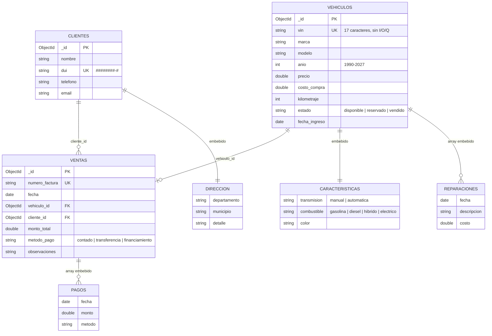

# Diagrama del modelo de datos (MongoDB)

Base de datos: `concesionario_db` · 3 colecciones · validación con `$jsonSchema`.



**Lectura del diagrama:** `VEHICULOS`, `CLIENTES` y `VENTAS` son colecciones. `CARACTERISTICAS`, `DIRECCION`, `REPARACIONES` y `PAGOS` no son colecciones: viven dentro del documento padre.

## Ejemplo de documento por colección

```json
// vehiculos
{
  "_id": ObjectId("..."),
  "vin": "1HGCR2F83HA000001",
  "marca": "Toyota", "modelo": "Corolla", "anio": 2019,
  "precio": 12500, "costo_compra": 9750, "kilometraje": 45000,
  "estado": "disponible",
  "fecha_ingreso": ISODate("2026-08-15"),
  "caracteristicas": { "transmision": "automatica", "combustible": "gasolina", "color": "Blanco" },
  "reparaciones": [ { "fecha": ISODate("2026-08-20"), "descripcion": "Cambio de llantas", "costo": 320 } ]
}

// clientes
{
  "_id": ObjectId("..."),
  "nombre": "Juan Pérez", "dui": "05123456-7",
  "telefono": "70001234", "email": "juan.perez@correo.com",
  "direccion": { "departamento": "San Salvador", "municipio": "San Marcos", "detalle": "Col. Las Brisas #12" }
}

// ventas
{
  "_id": ObjectId("..."),
  "numero_factura": "FAC-2026-0001",
  "fecha": ISODate("2026-09-10"),
  "vehiculo_id": ObjectId("..."),   // referencia a vehiculos
  "cliente_id": ObjectId("..."),    // referencia a clientes
  "monto_total": 12500,
  "metodo_pago": "financiamiento",
  "pagos": [ { "fecha": ISODate("2026-09-10"), "monto": 5000, "metodo": "transferencia" } ]
}
```

## Embeber vs. referenciar

| Relación | Decisión | Motivo |
|---|---|---|
| Vehículo → características | Embebido | Relación 1 a 1, siempre se lee junto con el vehículo |
| Vehículo → reparaciones | Array embebido | Pertenecen solo a ese vehículo, crecimiento acotado; se agregan con `$push` |
| Cliente → dirección | Embebido | 1 a 1; permite filtrar por `direccion.departamento` con índice |
| Venta → pagos | Array embebido | Un abono se agrega de forma atómica; el saldo se calcula en el mismo documento |
| Venta → vehículo y cliente | Referencia (`ObjectId`) | Son entidades independientes con su propio ciclo de vida; embeberlas duplicaría datos y haría crecer sin límite el documento del cliente. Se unen con `$lookup` en el detalle de venta y en los reportes |

## Claves e índices

| Colección | Índice | Tipo | Uso |
|---|---|---|---|
| vehiculos | `vin` | único | Identificador real del vehículo |
| vehiculos | `{ marca, modelo, anio }` | compuesto | Búsqueda de inventario |
| vehiculos | `estado` | simple | Filtrar disponibles; reporte de inventario |
| vehiculos | `fecha_ingreso` | simple | Días en inventario |
| clientes | `dui` | único | Documento de identidad |
| clientes | `direccion.departamento` | simple | Filtro por zona |
| ventas | `numero_factura` | único | Evita facturas duplicadas |
| ventas | `fecha` | descendente | Listado y reporte mensual |

## Reglas de integridad en la API

MongoDB no tiene llaves foráneas, así que la API las aplica:

- `POST /ventas` cambia el vehículo de `disponible` a `vendido` con un solo `findOneAndUpdate`. Si dos ventas llegan a la vez, solo una gana; la otra recibe 409.
- No se puede eliminar un vehículo ni un cliente que tenga ventas (409).
- Anular una venta devuelve el vehículo a `disponible`.
- Un vehículo no se puede marcar como vendido con `PUT`; solo mediante una venta.
